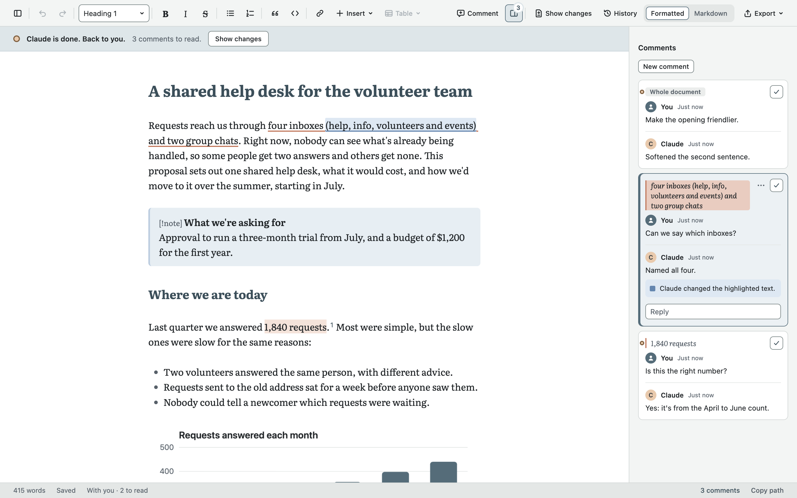

At work, I've used Kiro CLI to build apps for [my AI setup](https://oneillo.com/posts/my-ai-setup-at-work/) that make me more productive with my team of AI agents. This includes a Markdown editor, a task management app, and a system for automating tasks locally "borrowed" from OpenClaw's early code. These apps are such a core part of my workflow that I've started to make [clean room implementations](https://en.wikipedia.org/wiki/Clean-room_design) of them via Claude Code to use at home.

Over the past month, I've built personal versions of all of these apps, as well as some others that are only relevant to me at home, like one to help me publish blog posts I write.

I'm sharing the first app, [Corillo](https://github.com/oneillo/corillo), which is a collaborative Markdown editor for writing and refining documents in Markdown with your AI agents. 

The code is available at [github.com/oneillo/corillo](https://github.com/oneillo/corillo), and you can [download a MacOS installer from GitHub](https://github.com/oneillo/corillo/releases/latest).

The app includes instructions for how to connect it to your agents (tested on Claude Code, Claude desktop app on macOS, and Kiro CLI) and documentation on how to use it.

The goal of the app is to make collaborating with agents on Markdown documents feel like collaborating with teammates in Word. You can add comments to specific parts of the copy for your agent(s) to address, see a history of changes, and more. At the end, export a version in Word or PDF to share with others via one click, using a default format or a doc template you provide.

I built an app like this at work after realizing that one-shotting documents rarely led to something I felt comfortable sharing with others. Instead, I found I had to collaboratively refine documents with my agents, the same way I did with my manager and teammates. 

Many IDEs and GUI-based harnesses are starting to enable similar functionality: commenting on specific parts of Markdown text for agents to address. But I don't think they're optimized for creating documents as the final deliverable, and I prefer to work in the CLI, which is why I decided to make my own app. 

There's nothing particularly unique about these apps. They're built on open source and will therefore all be open sourced, meaning you can use them for free at home or for work. I act as a product manager, providing a vision, requirements, and UX direction based on my workflow. Claude Code does all of the coding.

There's nothing that prevents anyone from building a similar app using AI agents. That's part of what I find incredible about agentic AI. You can build tools for yourself to fit perfectly into the way you work to help you be more productive.

Corillo represents my judgement and design choices for an app that is key to my AI setup now.

Give it a whirl and see if it helps you be more productive with your agents or gives you ideas for your own apps.
