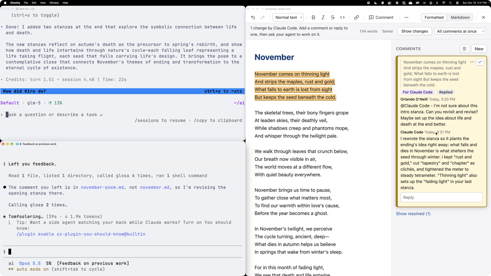

Over the past year, [the way I work has completely changed](https://oneillo.com/posts/my-llm-journey/). I now spend over 80% of my workday in the terminal working with [a team of AI agents](https://oneillo.com/posts/managed-ai-framework-overview/). They plan my day, triage my to-dos, pull and analyze my data, and even build the tools I use. When they need my judgment, they pull me in.

From what I've seen, I'm at the far end of what non-developers are doing with agentic AI. So I thought I'd share my setup as a reference.

If it starts to look like a lot, stick with me to the end. There's good news for anyone who wants to try something similar.

## Apps

Here are the core apps I use every day.

- [Kiro CLI](https://kiro.dev/cli/) - the app I use to run my AI agents at work. It runs in the terminal, which I find faster than clicking around an app, and it makes it super easy to switch between model families. For example, I can go from a Claude model to an OpenAI model, which is great for reviewing work and picking the right model for the job.
- [Ghostty](https://ghostty.org) - my preferred terminal and where most of my work happens. I used to run Kiro CLI in multiple Ghostty panes side by side. Now I start with Herdr instead.
- [Herdr](https://herdr.dev) - a tool for managing multiple AI agents at once. I can organize agents by the work they're doing, and I get a notification when one is done and waiting on me. It also lets one agent oversee a group of other agents while still keeping me in the loop.
- [OneDrive](https://www.microsoft.com/en-us/microsoft-365/onedrive/online-cloud-storage) / SharePoint - for backing up all of my local work, including my entire AI setup, and sharing documents with colleagues. I also use a SharePoint site as a low-tech shared [knowledge base](https://oneillo.com/posts/managed-ai-framework-knowledge-base/) for my team's AI agents. The Markdown files in the site sync to each of our laptops, so our agents can look things up in them while they work. It's not managed in Git the way a developer would set it up, but it's easy for a team of non-developers to use, and it comes with version control built in.
- [OmniFocus](https://www.omnigroup.com/omnifocus/) - my central to-do list. My agents add tasks here whenever something needs my attention: a message I flagged in Slack, a work item they found in my meeting notes, or an automated alert. I already used OmniFocus to track work (honestly, not as well as I would have liked), so it was an easy pick for the one list of everything I need to get done. 
- [Obsidian](https://obsidian.md) - for browsing my AI workspace. It's the fastest way I've found to move around folders and open specific Markdown files.
- Glosa (right side of the image below) - an app I built with Kiro CLI to enable me to collaborate with my AI agents on Markdown documents the same way I do with my teammates in Word. I started working on it when I realized how slow it was to copy and paste passages back into the terminal or point the agent at the thing I wanted it to change. I leave comments on specific parts of a document, and my agents pick them up and act on them. I can tag different agents on the same doc, even ones running in different apps. For example, I can ask my Data Wizard to check some calculations while my Writer reworks a separate passage (more on my agents below). It has sped up how quickly I get from an AI-written draft to something I'm comfortable sharing. Kiro IDE recently shipped [Markdown Review](https://kiro.dev/changelog/ide/1-3-11/), which is kind of like this.

## Agents

I have a team of [six custom Kiro agents](https://oneillo.com/posts/managed-ai-framework-build-your-team/) that I work with daily. 

| Agent | Role |
| --- | --- |
| Chief of Staff | Handles the logistics of my day-to-day. It helps me plan and time block my day every morning, triages to-dos into OmniFocus from various places, and writes my status updates. |
| Writer | On point for anything that involves, you guessed it, writing. I've tailored it to my voice and style gradually over the last 8 months. |
| Data Wizard | For all things data. It queries different data sources, helps me design experiments, analyzes performance results, and helps me think through analytical work. |
| LLM Expert | My go-to agent for improving my AI setup. It knows best practices for things like token efficiency (keeping down how much text the AI has to process, which affects speed and cost). I use it to tweak my agents' instructions, write [skills](https://oneillo.com/posts/managed-ai-framework-team-rules-and-skills/) (reusable instructions for specific tasks), and build out what I think of as my "AI operating system." |
| Dev | The newest member of the team. Now that I'm building more of my own tools, like Glosa, I wanted an agent dedicated to writing software. Any meaty software task goes to it. |
| Marketing Strategist | The agent I use least, because, well, that's my job! I work through ideas with it from time to time, but I'm considering cutting it since I rarely reach for it. |

My agents also work with each other. I often have several running at once, and through their instructions and Herdr, they can hand work off as needed. For example, if my Chief of Staff needs data it doesn't have access to, it either spins up a Data Wizard helper in the same session or starts a new Data Wizard session in Herdr with a brief describing what it needs.

## Systems

These are the core automations and processes in my setup.

### Heartbeat automation

When I started playing with OpenClaw, an open source AI agent, earlier this year, what struck me most was how much useful work it did proactively, without me asking. Since it's open source, I was able to dig into how it worked, and I basically stole the idea for myself. I now have a scheduled job on my MacBook (using launchd, the Mac's built-in scheduler) that checks every hour for anything my agents can do for me in the background. It only runs while my laptop is awake, but that's OK. Almost all of my work requires a human in the loop anyway.

Anything I want done automatically gets wired into this system. The list keeps growing, but the core job is triaging my to-dos and meeting notes: 

- In Slack, I tag a message as "Save for later" when I want it added to my to-dos.
- In email, I move anything I need to act on into a dedicated "Kiro" folder.
- My automated meeting summaries get routed to a separate inbox folder that Kiro knows to act on.

Every hour, my Chief of Staff reviews those items behind the scenes and creates tasks in OmniFocus for me. The result is that I'm much less likely to miss or forget something I've been asked to do.

### OneDrive backups

Every 30 minutes, an automated process backs up my AI setup to a synced OneDrive folder. Since an AI setup is mostly text files, it's easy to back up in case you ever need to recreate it on a different computer. It's even easier if you keep all of your AI-based work in one dedicated folder, your AI workspace. 

The backups also protect me from my own agents. If one deletes a file by accident, I can restore it from the OneDrive recycle bin on the web. That's saved me on multiple occasions. 

Initially, I was just copying files over. With Kiro's help, it's evolved into a sort of 1-click restore process I can use to quickly rebuild my setup on a new computer if I ever have to.

### My central dashboard

I support multiple products at work, and it's hard to stay on top of every project in flight and how each product is performing. So I had my agents build a local dashboard I can open in any web browser to check in on all of it. It's my command center, and I check it daily. 

The dashboard sits on top of an automated data pipeline connected to my Heartbeat automation. Every morning, my Data Wizard pulls the data I need on my products and campaigns from multiple sources and loads it into local databases behind the dashboard. Where possible, it queries databases directly using SQL. When it can't, it [works around the gap](https://oneillo.com/posts/agentic-ai-capability-gap/) with [Playwright CLI](https://github.com/microsoft/playwright-cli), opening a browser in the background and pulling data straight from dashboards and other websites.

The charts are built to my exact specifications, so I can see overall performance trends at a glance and double-click into issues when something looks off.

Once the data is in, my Data Wizard analyzes recent performance to look for outliers and issues that need my attention. Depending on how severe and urgent an issue is, it shows up on the dashboard, in email, in OmniFocus, or as a macOS notification. On top of that, every Monday morning it emails me a digest with performance data and a narrative, written by my Writer agent, of what's going on with my products, and at the start of each month, it sends me a monthly performance overview. 

### Agent evaluation tests

When I first started, I made a lot of changes to my agents, skills, and system prompts to address issues, but I didn't have a way to test if they were actually making things better. I was "vibe testing" the improvements, and I wanted something more rigorous. After researching agent eval frameworks, I built a simple, automated version into my setup. 

If I want to make a change to a custom agent, skill, or system prompt (steering file in Kiro), my LLM Expert agent can kick off my agent evaluation system in the background to check how it performs against the current baseline. 

The evaluation is done by comparing the current version with the proposed update on a set of predefined tests. For example, if I'm changing my Writer agent, it goes through a set of defined prompts asking it to do things like write an email communicating a status update, write a short document, write marketing copy for push notifications, etc. Their output is then evaluated against a list of criteria for each scenario, like checking if the output contains too many em dashes. 

At the end, if the proposed improvements are no worse than the current version, they get promoted and become my new baseline.

A few months ago I significantly trimmed the token cost of my setup, and this was how I ensured it didn't worsen my AI setup's performance.

### Folder-based project management

This system gives my agents the context they need to write my status updates and nudge me on work that needs my attention. It has two parts: a standard folder structure and a context.md file in every project folder.

Every product I support has a folder that contains all of its projects. Every project I'm working on gets its own folder with all of the context my agents and I need for it. Those project folders live inside a set of status folders that show where each project sits in its lifecycle:

- Projects I'm currently working on
- Completed projects
- Abandoned projects
- Backlog for projects I'll get to next

Just by checking which folder a project is in, my agents know its high-level status.

Each context.md file starts with a standardized YAML header, a block of structured fields at the top of the file, that holds the key details needed for reporting: milestones, next steps, relevant links,  resources, etc. My agents read that header along with the rest of the file to draft my status reports and figure out what I need to work on next to keep projects moving.

## Start small

If you've read this far and feel a little overwhelmed, I get it. It looks like a lot. But I have good news.

First, your AI agents can do most, if not all, of the heavy lifting. I provide oversight, guidance, and taste, but 99% of my setup was built by my Kiro agents.

Second, none of this happened at once. My setup last March was drastically simpler than what I have today. Over 8 months of using AI agents daily, I've added one piece at a time, [usually in response to a specific pain point](https://oneillo.com/posts/managed-ai-framework-feedback-loop/), and made sure I understood what each piece did and how it fit with the rest. That's how I'd recommend you do it too. Pick one annoying problem, have your agent help you solve it, and build from there.

When it comes to my setup, my goal is to use the minimum number of things I need. I don't like complexity for the sake of complexity, and I'm still pruning. My Marketing Strategist might not survive the year.

At this point, I can't imagine going back to the way I worked before agentic AI. To me, AI agents have been as transformative to how I work as computers, laptops, and wifi. There's no going back.

---

*A note on how this post was written: I wrote the first draft myself, including all of the ideas, examples, and details about my setup. Then I used AI to help me tighten and refine it into the final version. Given the topic, it only seemed fitting.*

